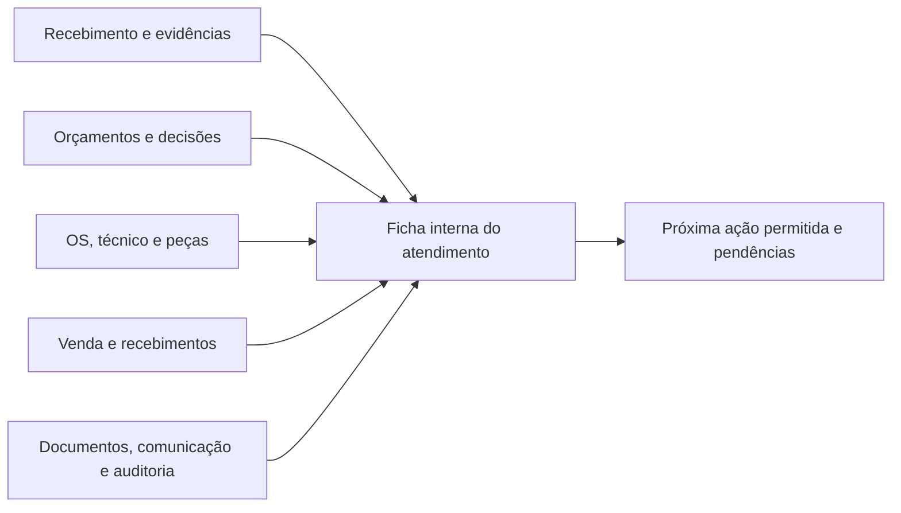

# Plano incremental de implementação

> Continuação de 08/11/2026: [Lote 6 — edição composta de orçamento](09-implementacao-lote-6.md) implementado localmente. Rascunho, itens, totais e auditoria são atualizados juntos com controle de revisão.

> Continuação de 08/11/2026: [Lote 7 — consultas e ações por perfil](10-implementacao-lote-7.md) implementado parcialmente no frontend. Falhas de consulta e permissões vazias deixam de aparecer como dados vazios ou acesso presumido nas telas centrais do fluxo.

> Continuação de 08/11/2026: [Lote 8 — acessibilidade de formulários e listas](11-implementacao-lote-8.md) implementado parcialmente. Campos, mensagens de erro, filtros e botões genéricos ganharam relações e rótulos mais claros para teclado e leitor de tela.

> Continuação de 08/11/2026: [Lote 9 — autoria da OS e proteção do recebimento vinculado](12-implementacao-lote-9.md) implementado parcialmente no backend. Ações HTTP de OS passam o operador autenticado; exclusão de recebimento bloqueia referências históricas e registra o evento.

> Continuação de 08/11/2026: [Lote 10 — rotas antigas e contexto de navegação](13-implementacao-lote-10.md) implementado parcialmente. A rota antiga de edição do recebimento explica o redirecionamento; fichas e endereços inválidos recebem contexto mais claro.

> Continuação de 08/11/2026: [Lote 11 — disponibilidade de indicadores e relatórios](14-implementacao-lote-11.md) implementado parcialmente no frontend. Erros de leitura e respostas inválidas deixam de virar zero ou lista vazia nas áreas centrais dos indicadores; há nova tentativa.

> Continuação de 08/11/2026: [Lote 12 — referências legíveis nas telas](15-implementacao-lote-12.md) implementado parcialmente no frontend. Referências sem nome não exibem ObjectId como se fosse cliente; listas de pagamento deixam de usar trecho do ID como número de negócio.

> Continuação de 08/11/2026: [Lote 13 — reflow e ações acessíveis em relatórios](16-implementacao-lote-13.md) implementado parcialmente no frontend. Relatórios operacionais se reorganizam em telas menores e ações de abertura podem ser usadas por teclado.

> Continuação de 08/11/2026: [Lote 14 — referências legadas identificadas](17-implementacao-lote-14.md) implementado parcialmente no frontend. Sufixos de ObjectId em listas de OS/orçamento foram renomeados como referências legadas, sem apresentá-los como códigos oficiais.

> Continuação de 08/11/2026: [Lote 15 — autoria real nas mudanças de orçamento](18-implementacao-lote-15.md) implementado parcialmente no backend. Ações de status e cancelamento feitas por usuário autenticado passam a ser atribuídas a quem executou a ação.

> Continuação de 08/11/2026: [Lote 16 — autoria em itens de venda](19-implementacao-lote-16.md) implementado parcialmente no backend. Inclusão, alteração e remoção direta de itens agora registram a pessoa autenticada e os detalhes da alteração na venda.

> Continuação de 08/11/2026: [Lote 17 — linha do tempo legível](20-implementacao-lote-17.md) implementado parcialmente no frontend. Detalhes de auditoria ocultam chaves internas e a linha do tempo oferece nova tentativa.

> Continuação de 08/11/2026: [Lote 18 — navegação lateral sem destaques duplicados](21-implementacao-lote-18.md) implementado parcialmente no frontend. Em uma página filha, apenas o item de menu mais específico fica ativo e é anunciado como página atual.

> Continuação de 08/11/2026: [Lote 19 — nomes amigáveis na linha do tempo](22-implementacao-lote-19.md) implementado parcialmente no frontend. Eventos e operações de auditoria têm rótulos em português, inclusive registros financeiros e fiscais.

> Continuação de 08/11/2026: [Lote 20 — referências legíveis em vendas e compras](23-implementacao-lote-20.md) implementado parcialmente no frontend. Cliente e fornecedor não mostram ObjectId quando a API não retorna o registro relacionado.

> Continuação de 08/11/2026: [Lote 21 — valores e situações financeiras legíveis](24-implementacao-lote-21.md) implementado parcialmente no frontend. Listas de vendas e compras usam formato monetário brasileiro e não transformam valor ausente ou inválido em zero.

> Continuação de 08/11/2026: [Lote 22 — registro fiscal sem números ou tributos fictícios](25-implementacao-lote-22.md) implementado parcialmente no frontend. A tela não usa ObjectId como código de verificação, não inventa número de NFSe e não apresenta estimativas tributárias fixas como cálculo oficial.

> Continuação de 08/11/2026: [Lote 23 — IDs fora de comprovantes e comunicações](26-implementacao-lote-23.md) implementado parcialmente no frontend. Recibos, garantias e mensagens ao cliente deixam de tratar ObjectId como número comercial.

> Continuação de 08/11/2026: [Lote 24 — PDFs sem protocolos derivados de IDs](27-implementacao-lote-24.md) implementado parcialmente no backend. PDFs deixam de imprimir sufixos de ObjectId como número/código do documento e deixam de usá-los no nome do arquivo.

> Continuação de 08/11/2026: [Lote 25 — estados e meios de pagamento legíveis nos PDFs](28-implementacao-lote-25.md) implementado parcialmente no backend. Situações comuns e formas de pagamento recebem rótulos em português nos documentos.

> Continuação de 08/11/2026: [Lote 26 — OS somente após aprovação do orçamento](29-implementacao-lote-26.md) implementado parcialmente no backend e frontend. A escolha registrada foi criar a OS após aprovação; a OS inicia aberta e usa os vínculos do orçamento aprovado.

> Continuação de 08/11/2026: [Lote 27 — devolução sem reparo e sem cobrança automática](30-implementacao-lote-27.md) implementado parcialmente no backend e frontend. A decisão registrada foi encerrar com motivo, preparar a devolução e registrar o recebimento do equipamento, sem gerar venda ou taxa.

> Continuação de 08/11/2026: [Lote 28 — autorização e assinatura na retirada](31-implementacao-lote-28.md) implementado parcialmente no backend e frontend. Cliente ou terceiro autorizado; nome, confirmação da autorização e assinatura ficam vinculados ao registro da entrega ou devolução.

> Continuação de 08/11/2026: [Lote 29 — códigos operacionais e listas paginadas](32-implementacao-lote-29.md) implementado localmente no backend e frontend. Novas entradas, orçamentos e OS recebem códigos por empresa/tipo/ano; as três listas centrais usam busca e páginas do servidor, mantendo as rotas antigas de lista.

> Continuação de 08/11/2026: [Lote 30 — aviso de possíveis clientes duplicados](33-implementacao-lote-30.md) implementado localmente no backend e frontend. Documento já cadastrado orienta a localizar o registro existente; coincidências de nome/telefone pedem conferência explícita, sem mesclagem automática.

> Continuação de 08/11/2026: [Lote 31 — confirmação de comunicação](34-implementacao-lote-31.md) implementado localmente no backend e frontend. A mensagem começa como preparada; alterações posteriores exigem confirmação manual, autoria e observação, sem automação externa.

> Continuação de 08/11/2026: [Lote 32 — indicadores e prazo combinado](35-implementacao-lote-32.md) implementado localmente no backend e frontend. Vendas canceladas, vendas não canceladas e recebimentos confirmados aparecem separados; atrasos usam apenas previsões de entrega preenchidas e vencidas.

> Continuação de 08/11/2026: [Lote 33 — checklist de qualidade na OS](36-implementacao-lote-33.md) implementado localmente no backend e frontend. A conclusão exige os sete itens respondidos, sem falhas abertas; falhas pedem observação, alterações têm revisão e autoria, e o checklist fica visível na OS e no histórico.

> Continuação de 08/11/2026: [Lote 34 — correção versionada de checklist concluído](37-implementacao-lote-34.md) implementado localmente no backend e frontend. Administrador, administrador da empresa ou gerente podem registrar nova revisão, com justificativa obrigatória; a OS permanece concluída e a revisão anterior fica auditada.

> Continuação de 08/11/2026: [Lote 35 — categorias e testes por equipamento](38-implementacao-lote-35.md) implementado localmente no backend e frontend. O recebimento agora registra uma categoria padronizada, preservando a descrição livre; a OS combina o checklist-base com testes próprios de celular, tablet, notebook ou computador de mesa.

> Continuação de 08/11/2026: [Lote 36 — PDF técnico por revisão do checklist](39-implementacao-lote-36.md) implementado localmente no backend e frontend. A ficha da OS lista as versões auditadas e permite baixar um PDF técnico separado por versão; os dados estruturados ficam na trilha de auditoria, sem alterar o comprovante assinado de retirada.

> Continuação de 08/11/2026: [Lote 37 — preflight e ativação dos índices de protocolo](40-implementacao-lote-37.md) executado em homologação: zero conflitos antes da ativação; índices únicos de recebimentos, orçamentos e OS criados e conferidos.

> Continuação de 08/11/2026: [Lote 38 — busca contextual de cliente no recebimento](41-implementacao-lote-38.md) implementado localmente no frontend. A seleção pode ser filtrada por nome, CPF/CNPJ, telefone ou e-mail, com acentos e pontuação tolerados; identificadores técnicos não são exibidos.

> Continuação de 08/11/2026: [Lote 39 — busca de listas sem consultas a cada tecla](42-implementacao-lote-39.md) implementado localmente no frontend. Listas paginadas aguardam 300 ms após a última tecla antes de consultar o servidor, mantendo os filtros atuais.

> Continuação de 08/11/2026: [Lote 40 — próxima ação clara após aprovação do orçamento](43-implementacao-lote-40.md) implementado localmente no frontend. A ação disponível após aprovação agora diz “Iniciar reparo” e explica que abrirá a OS para diagnóstico e execução.

> Continuação de 08/11/2026: [Lote 41 — retirada mais clara na ficha da OS](44-implementacao-lote-41.md) implementado localmente no frontend. O nome do cliente é sugerido na retirada, o identificador técnico da assinatura fica recolhido e a captura informa o nome como obrigatório.

> Continuação de 08/11/2026: [Lote 42 — orientação simples para concluir testes de qualidade](45-implementacao-lote-42.md) implementado localmente no frontend. A ficha informa quantos testes precisam de resultado ou solução e encaminha inconsistências do checklist para revisão responsável.

> Continuação de 08/11/2026: [Lote 43 — avisos da OS acessíveis](46-implementacao-lote-43.md) implementado localmente no frontend. Pendência financeira, falhas de ação e confirmações de comunicação agora são anunciadas como mensagens de estado.

> Continuação de 08/11/2026: [Lote 44 — acompanhamento de OS aguardando retirada](47-implementacao-lote-44.md) implementado localmente no frontend. A tela mostra a pendência de retirada após reparo pago, e a mensagem manual de status pode informar “Aguardando retirada”; sem envio automático nem cobrança.

> Continuação de 08/11/2026: [Lote 45 — status de retirada coerente no portal do cliente](48-implementacao-lote-45.md) implementado localmente no frontend. O portal separa “Serviço concluído” do estado “Aguardando retirada”, que só aparece após pagamento confirmado; a entrega registrada aparece como entregue.

> Continuação de 08/11/2026: [Lote 46 — cadastro de cliente sem abandonar o recebimento](49-implementacao-lote-46.md) implementado localmente no frontend. Quando a busca não encontra cliente, quem tem permissão pode abrir o cadastro em outra aba e atualizar a lista mantendo a entrada atual aberta.

> Estado em 08/11/2026: [Lotes 1–46](04-implementacao-lote-1.md) implementados localmente, com os Lotes 7–46 parciais nos escopos descritos; relatórios individuais até [Lote 46](49-implementacao-lote-46.md). D5 confirma que não há atalhos administrativos; a OS continua dependendo de orçamento aprovado. Estados de diagnóstico e autorização ainda precisam de revisão completa. D6 cobre sem reparo e acompanha retirada de serviço concluído sem taxa automática; avisos seguem preparados manualmente, sem prazo/cadência automática definidos. D7 inclui retirada por terceiro autorizado, checklist-base e testes adicionais por categoria, correção pós-conclusão em nova revisão auditada e PDF técnico acessível por revisão. D8 inclui protocolos e paginação aditiva; os três índices únicos foram ativados em homologação após preflight sem conflitos. Backfill de registros sem código e revisão das demais listas continuam pendentes. D9 avisa possíveis duplicatas sem mesclar clientes e oferece busca contextual e cadastro em outra aba no recebimento; normalização histórica continua pendente. D10 agora permite confirmação manual auditável; integração com provedor não foi escolhida. D11 separa vendas e recebimentos, identifica cancelamentos e calcula atrasos apenas com data prometida; OS antigas continuam sem previsão até que o operador a registre. Nenhuma publicação de código ou backfill foi executado.

Data: 06/11/2026. Diagnóstico e evidências: [01-diagnostico.md](01-diagnostico.md). Lotes aplicados e resultados: [03-validacao.md](03-validacao.md). BE/FE são as raízes definidas no diagnóstico.

## Escopo autorizado e ponto de aprovação

O pedido autoriza correções locais reversíveis e exige confirmação antes de alterar estruturas, estados persistidos, contratos públicos, migrações de risco ou políticas comerciais/legais. O lote já aplicado mantém schemas e contratos públicos. A validação adicional de referências apenas recusa vínculos que violavam o isolamento já esperado.

**A descrição abaixo preserva a proposta inicial dos lotes, com os itens 7/8 atualizados para a entrega local do arquivo05.** D1–D4 foram implementadas no escopo do arquivo04; D4 foi estendida com rascunhos. A ficha compõe fatos existentes, sem encerrar D5 como política de cardinalidade ou transição. O sistema ainda tem lacunas de jornada e homologação.

## Backlog ordenado

Estimativa relativa: **P** = pequena/local, **M** = várias telas/serviços, **G** = mudança transversal/dados. Não são dias de calendário. Risco considera comportamento/dados; migração indica a necessidade, não autorização para executá-la.

| Ordem / prioridade | Item e arquivos/camadas | Depende de | Esforço / risco / dados | Teste e aceite observável |
|---|---|---|---|---|
| 0 / P0 | **Vínculos entre empresas — aplicado.** BE OS/orçamento/portal e teste tenant | Helper `common/tenant-reference.ts` existente | M / baixo-médio / sem migração | A→A aceito, A→B negado em escrita e nomes/dados de B ausentes em leitura legada; 14 integrações passaram. Escopo não cobre automaticamente todos os módulos. |
| 1 / P0 | **Ledger/saldo do estoque.** BE `estoque.service.ts`, schemas saldo/movimento, compras, OS e venda; FE movimentos/pendências | D1: política de edição/estorno e reconciliação | G / alto / relatório de divergências e migração compatível, aprovar antes | Reproduzir defeito; teste deve impedir saída após excluir entrada; atualização de produto/quantidade e falhas transacionais preservam ledger/cache/reservas; carga concorrente sem negativo. |
| 2 / P0 | **Integridade financeira.** BE `vendas.service.ts`, pagamentos, financeiro-adm, DTOs/controllers; FE venda/pagamento | D2: quitação derivada e tratamento de exceções legadas | G / alto / diagnóstico antes de qualquer correção de saldo | Isolar falha código251; vendas não pode declarar pago sem registro autorizado; parcial/múltiplos meios/estorno/rollback não excedem total e mantêm caixa/título/venda. |
| 3 / P0 | **Pix por empresa.** FE PortalClientePage; BE empresa/portal/configuração de cobrança | D3: fonte e beneficiário | M / alto financeiro / novo campo/contrato, sem reaproveitar chave global | Empresas A/B recebem só suas configurações; não configurada não oferece QR/chave global; identidade do beneficiário revisável e acesso de edição restrito/auditado. Não testar com transferência real. |
| 4 / P0 | **Recebimento composto recuperável.** BE módulo recebimento/comando/upload; FE recebimento.service e Form | D4: contrato idempotente, retenção do rascunho e evidências | G / alto / novos campos/coleção auxiliar opcionais; antigos continuam válidos | Queda antes/depois do commit, anexo falho, resposta perdida e retry retornam mesmo registro, sem termo/foto silenciosamente descartado. |
| 5 / P0/P1 | **Orçamento composto e início válido — criação e edição composta aplicadas nos Lotes 3 e 6.** BE orcamentos.service/controller/DTO/schema/state; FE OrcamentoForm | Item4 para padrão comum, D4 e D5 | G / médio-alto / contrato aditivo e versão opcional | Criação e edição de rascunho gravam itens/totais/cabeçalho juntos; edição usa revisão esperada e conflito concorrente. Política para revisão após envio e regras excepcionais permanece pendente. |
| 6 / P1 | **Concorrência e recuperação de OS/venda — aplicado parcialmente nos Lotes 4–5.** BE `common/bloquear-origem.ts`, OS, orçamento e vendas; FE orçamento/venda | Itens1/2/5 e D5 | G / alto / índice único aditivo para `operacoesVendas` descrito no plano; aplicar antes da publicação e tratar conflitos | OS por orçamento e venda por OS serializadas; envio completo de venda recuperável por chave da empresa; legado duplicado/conflitante devolve 409. Reservas/estoque, cancelamento e retirada idempotente continuam pendentes. |
| 7 / P1 | **Ficha interna de atendimento — projeção de leitura implementada no Lote 2.** Endpoint BE e ficha/rotas/links FE | Vínculos e permissões existentes; D5 continua pendente para mudar as regras | G / médio / sem reparentear dados ou criar estado persistido de atendimento | Cliente/equipamento/responsáveis, estados separados, histórico recente, acesso aos documentos e próxima ação por papel. Perfis sem permissão não disparam consulta financeira. Homologação de balcão pendente. |
| 8 / P1 | **Assistente de entrada e rascunho — implementados localmente no Lote 2.** Form ativo, revisão e rascunho com revisão | Comando composto do item4/D4 | G / médio / nova coleção auxiliar; publicação coordenada BE/FE e índices, sem deploy realizado | Cinco etapas, navegação preservando campos, revisão antes do aceite, sucesso na ficha, autosave com conflito entre abas. Browser com fixture e layout 390px verificados. Câmera/arquivos reais/assinatura por toque ainda pendentes. |
| 9 / P1 | **Estados e exceções.** BE states/transitions e comandos; FE ficha/portal/OS/orçamento | D5/D6/D7; itens2/6/7 | G / alto / apresentação derivada primeiro, eventos/novos estados só após decisão | Conclusão técnica nunca equivale automaticamente a entrega; recusa/sem conserto tem caminho de devolução; revisão exige nova autorização; canal interno/portal expiram pela mesma regra. |
| 10 / P1 | **Listas operacionais no servidor e protocolos — aplicado parcialmente nos Lotes 29 e 37.** BE queries/contador/índices declarados; FE GenericList e listas centrais | D8; item7 para próxima ação | G / médio / endpoint/contrato aditivo; protocolo opcional e backfill aprovado | Recebimentos, orçamentos e OS usam paginação do servidor, busca/filtros combinados, total e ordenação estável; número é reservado atomicamente e tem unicidade declarada por empresa. Rotas de array existentes continuam. O preflight em homologação encontrou zero conflitos e os três índices únicos foram ativados e conferidos. Backfill de registros antigos sem número e revisão das demais listas continuam pendentes. |
| 11 / P1 | **Consultas/ações por papel — aplicado parcialmente no Lote 7.** FE serviços getAll do fluxo, PermissionProvider, useBusinessEvents, detalhes cliente/OS; BE mantém a autorização final | Item7 e matriz existente | M / médio / API pode permanecer igual; distinguir estados FE | No escopo central do fluxo, erro não vira vazio/zero, áreas sem permissão não são consultadas no histórico do cliente, ação indisponível explica encaminhamento, retry é só leitura e resposta remota vazia não amplia acesso via fallback. Migração dos demais módulos e homologação por perfil pendentes. |
| 12 / P1 | **Qualidade e retirada — aplicado parcialmente nos Lotes 33–36.** FE ficha/OS/PDF, BE entrega/DTO/schema/documentos/auditoria | Itens2/7/9 e D6/D7 | G / alto / campos opcionais/checklist e evento, versionar comprovante | Checklist-base com sete testes e testes adicionais definidos pela categoria; “Não se aplica”, falha com observação, gravação parcial auditada e bloqueio da conclusão enquanto houver pendências/falhas. Correções pós-conclusão criam nova revisão auditada com motivo e permissão de responsável. Terceiro e assinatura seguem conforme regra aprovada. PDF técnico por versão acessível na ficha. Ensaios do fluxo permanecem pendentes. |
| 13 / P1 | **Cliente contextual e duplicatas.** FE select/clientes; BE busca/normalização | Item10; D9 se documento mudar | M / médio / busca aditiva, não merge automático | Localizar por nome/telefone/documento; cadastro no contexto volta preenchido; duplicata mostra registro existente; mesmo telefone não funde clientes distintos. |
| 14 / P2 | **Comunicação comprovável — confirmação manual aplicada no Lote 31.** FE serviço/histórico; BE notificações | D10; provedor somente se integração for escolhida | M / médio / metadados opcionais, sem migração | Nova mensagem começa como preparada; o status não pode ser editado diretamente. Confirmação manual registra origem, pessoa, data e observação; o histórico sinaliza registros antigos sem origem comprovável. Não há callback nem envio automático configurado. |
| 15 / P2 | **Acessibilidade/tokens/responsividade — aplicado parcialmente nos Lotes 8, 12–14.** FE ResourceForm, GenericListPage, referências operacionais, relatórios e CSS | QA visual disponível; D7 para alternativa de assinatura | M / baixo-médio / sem migração | Labels, ajuda, erro/foco/teclado e ações genéricas com contexto foram melhorados. Referências sem nome não expõem IDs técnicos como nomes de pessoas; relatórios refluem para uma coluna abaixo de 900px e ações usam botões; sufixos legados são identificados como referência, não protocolo. Contraste, leitores de tela, zoom e validação visual em 360/768/1280px continuam pendentes; assinatura permanece sujeita a D7. |
| 16 / P2 | **Indicadores confiáveis — D11 aplicado localmente no Lote 32.** FE dashboard/OS; BE resumo financeiro/OS | Regras financeiras válidas e prazo realmente combinado | M / médio / endpoint aditivo e campo opcional, sem migração de dados | Vendas não canceladas, cancelamentos e recebimentos válidos são separados; saldo recebido só aparece a quem tem permissão de consultar pagamentos. A previsão opcional é gravada na OS, auditada e mostrada no portal. Atraso só conta em OS ativa depois da data combinada; sem previsão, a OS entra em “sem previsão”. Totais são acumulados, e o painel ainda carrega listas de vendas/OS no cliente. OS históricas não recebem prazo artificial. |
| 17 / P2 | **Auditoria pelo ator e proteção de vínculos — aplicado parcialmente nos Lotes 9, 15–17 e 19.** BE OS/reservas/orçamento/venda/comandos/recebimento; FE AuditTimeline | Matriz existente e itens6/9 | M / médio / evento aditivo; sem migração | Ações HTTP de OS, mudanças de orçamento e alterações diretas de itens de venda registram operador autenticado; linha do tempo oculta IDs internos e traduz eventos, operações e detalhes. Remoção de entrada recusa OS/orçamento/documentos vinculados e remoção livre gera evento. Decisões de portal ainda recorrem ao criador como compatibilidade; chamadas internas sem ator, outros vínculos e teste integrado seguem pendentes. Auditoria guarda hash, não imagem bruta da assinatura. |
| 18 / P3 | **Navegação/código legado — aplicado parcialmente nos Lotes 10 e 18.** FE routes antigas, menu lateral e contexto Topbar | Ficha e rotas finais | P-M / baixo / sem migração | A antiga edição de recebimento redireciona com explicação, a ficha aparece no contexto superior e o 404 orienta a volta. O menu destaca somente a rota atual mais específica. As demais rotas antigas ainda precisam de inventário de uso antes de serem alteradas ou removidas. |
| 19 / P2 | **Referências legíveis nas listagens — aplicado parcialmente nos Lotes 12, 14, 20 e 29.** FE listas de recebimento, OS, orçamento, garantia, pagamento, venda e compra | API deve devolver relações populadas quando possível | P / baixo / sem migração | Listas do fluxo principal mostram códigos de negócio nos novos recebimentos, orçamentos e OS; registros antigos são identificados sem exibir trechos do ObjectId. Histórico do cliente, dashboard, portal e comunicações usam os mesmos códigos quando existem. Outras listagens e relações ainda precisam revisão. |
| 20 / P2 | **Valores e situações legíveis nas listas financeiras — aplicado parcialmente no Lote 21.** FE pedidos de compra e vendas | Estados do serviço financeiro existentes | P / baixo / sem migração | Valores válidos aparecem como moeda pt-BR; valor ausente/inválido é indicado como indisponível, sem virar zero. Status conhecidos de venda e compra têm rótulos em português; definições de quitação e demais regras financeiras continuam no item 2/D2. |
| 21 / P1 | **Registro fiscal sem valores fictícios — aplicado parcialmente no Lote 22.** FE formulário e detalhe de NFSe | Integração oficial e cálculo dependem de política/fornecedor fiscal | P / médio / sem alteração de API | O formulário deixa de inventar número e informa que não envia à prefeitura; detalhe não chama ObjectId de código de verificação nem mostra estimativas tributárias fixas. Emissão efetiva, validação de XML/PDF, protocolo e cálculos continuam pendentes de integração e homologação fiscal. |
| 22 / P2 | **IDs fora de comprovantes e comunicações — aplicado parcialmente no Lote 23.** FE detalhes de venda, pagamento, garantia e OS | Protocolo comercial (D8) permanece pendente | P / baixo / sem migração | Cabeçalhos, vínculos e mensagens a clientes usam número real quando disponível; na ausência dele, indicam que não há número. Mensagens deixam de rotular sufixos de ObjectId como OS/venda/garantia. Referências curtas legadas continuam identificadas apenas nas telas internas. |
| 23 / P2 | **PDFs sem protocolos derivados de IDs — aplicado parcialmente no Lote 24.** BE DocumentosService/Controller | D8 para protocolo oficial | P / baixo / sem migração | Orçamento, recibo, resumo de atendimento e termo não inventam número com sufixo do ObjectId; quando um número comercial real existe, ele é usado. Referências de item sem cadastro não expõem o ID. O arquivo baixado também não inclui o ID no nome. |
| 24 / P2 | **Rótulos dos dados nos PDFs — aplicado parcialmente no Lote 25.** BE DocumentosService | Estados existentes | P / baixo / sem migração | Tipo de item, estados operacionais/financeiros comuns e meios de pagamento aparecem em português; a lógica de cálculo e os valores não são alterados. Valores novos de enum ainda precisam de revisão periódica. |

## Arquitetura proposta da ficha interna

Primeira versão: **projeção de leitura** dos vínculos já existentes, com recebimento como ponto de entrada. Não criar uma segunda fonte de verdade para venda/pagamento/estoque. Atendimento é o nome da experiência; a adoção de um agregado persistido novo seria uma decisão posterior. Um mesmo aparelho pode ter vários atendimentos ao longo do tempo; nunca inferir unicidade pelo IMEI sozinho.

O agregador retorna resumo do cliente/equipamento, protocolo (ou referência legada), orçamento(s), OS, documentos, pendências, responsáveis e ações autorizadas. A política de cardinalidade precisa ser explícita: versões de orçamento não podem gerar várias OS ativas por acidente; retornos devem ligar ao atendimento original. Dados de outros papéis são omitidos ou marcados “sem acesso”, não como lista vazia.



### Modelo de apresentação dos estados

Sem migrar imediatamente todos os enums, derivar a apresentação de fatos confirmados. O BE deve fornecer a derivação para FE/portal não divergirem. Não deduzir “pago” de ausência de pagamentos carregados ou do total inventado pelo cliente HTTP.

| Eixo | Fatos existentes | Apresentação proposta | Mudança pendente |
|---|---|---|---|
| Entrada | recebimento e termo/evidências | Entrada incompleta / Recebido | Definir rascunho/completude e exceções de termo |
| Aprovação | status e validade do orçamento | Em preparação / Aguardando cliente / Aprovado / Recusado / Expirado / Cancelado | Revisão versionada e validade uniforme |
| Técnico | statusOperacional e dataConclusao | Aguardando diagnóstico / Em diagnóstico / Aguardando peça / Em reparo / Serviço concluído / Encerrado sem reparo | Registro de diagnóstico/qualidade e exceção sem reparo |
| Financeiro | venda e pagamentos/estornos válidos | Pendente / Parcial / Pago / Indisponível / Sem acesso | Quitação derivada, crédito e total zero aprovados |
| Posse | dataEntrega/assinatura e responsável | Na assistência / Aguardando retirada / Entregue ou Devolvido | Diferenciar devolução sem reparo; impedir sobrescrita |

“Aguardando retirada” indica serviço encerrado e aparelho ainda na assistência; se existe saldo, mostrar explicitamente “Saldo pendente de R$…”. O rótulo “Liberado para entrega” depende da política financeira vigente. Não prometer liberação por conclusão técnica. Reabertura deve preferir retorno vinculado para manter histórico, sujeito a aprovação.

### Contratos de API propostos, aditivos

Os exemplos abaixo preservam a proposta arquitetural original. O contrato efetivamente implementado de recebimento está no arquivo04; ficha e rascunhos estão no arquivo05. Em particular, o rascunho usa `/rascunhos-recebimento/:operacaoId` com revisão no corpo, e não o PATCH hipotético abaixo. Os demais exemplos continuam futuros:

```text
GET /atendimentos/:recebimentoId
  empresa do usuário + permissão por seção
  -> { referencia, equipamento, cliente, etapas, pendencias,
       responsaveis, documentos, acoesPermitidas, revisao }
  dados financeiros: { estado: disponivel | sem_acesso | indisponivel, ... }

POST /recebimentos/completo
  Idempotency-Key (escopo empresa + ator + operação)
  -> { recebimentoId, protocolo?, estado: rascunho|confirmado, pendencias, revisao }
  chave + hash do payload: mesma chave/mesmo conteúdo retorna mesma operação;
  mesma chave/conteúdo diferente -> 409, sem novo cabeçalho.

PATCH /recebimentos/:id/rascunho
  If-Match/revisao esperada -> 409 ao divergir; uploads anexados por referência
POST /recebimentos/:id/confirmar
  valida completude e devolve protocolo/ficha

POST /orcamentos/completo
  cabeçalho/itens/totais validados no servidor + chave idempotente
POST /orcamentos/:id/revisoes
  nova versão, motivo e validade; aprovação anterior não autoriza versão alterada

GET /atendimentos?busca=&etapa=&tecnico=&prioridade=&cursor=&limite=25
  -> { items, nextCursor, total?, filtrosAplicados }
  ordenação estável data+_id, limites e allowlist de filtros no servidor

POST /ordens-servico/:id/entregas
  chave idempotente, revisão, checklist e recebedor conforme política
  -> registro/comprovante imutável ou retorno da mesma entrega
```

Preservar GETs existentes e seus arrays para clientes atuais. Introduzir rota ou negociação explícita para paginação; não trocar silenciosamente array por envelope. A API agregada só resolve referências com empresa e vínculo correspondente; campos como autor/empresa/data de evento vêm da sessão/servidor. Transições exigem evento autorizado e estado/versão esperado numa atualização condicional. Lista de ações não substitui guard no comando.

### Operações compostas e anexos

Usar transação para dados que cabem no MongoDB; arquivos externos não participam automaticamente dessa transação. Proposta: upload temporário privado identificado por operação, validação/hash e confirmação de vínculo após commit; falha mostra anexo pendente. Uma rotina de limpeza de temporários exige prazo/retensão aprovado e nunca remove arquivos associados confirmados. Não tentar resolver idempotência só desabilitando o botão.

Para protocolo: contador atômico por `{empresaId, tipo, ano}`, índice único `{empresaId, protocolo}` parcial para registros já numerados. Reservar código no servidor, aceitando lacunas; sequência sem lacunas exigiria complexidade sem benefício operacional. Registros antigos continuam acessíveis por ID e recebem referência explícita até backfill aprovado. Fazer simulação de colisões/concorrência e relatório de duplicatas antes de ativar índices únicos de origem.

## Wireframes textuais

### Fila operacional

```text
Atendimentos                       [Novo recebimento]
[Buscar nome, telefone, protocolo, serial…]
[Etapa: todas] [Técnico] [Prioridade] [Prazo] [Limpar]
Abas: Meus | Aguardando cliente | Peças | Reparo | Retirada
Protocolo / Cliente / Equipamento / Etapa / Responsável / Tempo parado / Próxima ação
OS-2026-001248 · João · Celular Marca Modelo · Aguardando peça · Ana · 2 dias · Ver compra
[Anterior] 25 registros [Próxima página]
```

Busca/filtros/ordenação ficam na URL sem tokens ou dados sensíveis além da busca digitada; avaliar se telefone/documento deve usar estado local conforme política de privacidade. O lote atual guarda termos na URL e não grava persistência adicional. Layout móvel mostra resumo com nome/item/etapa e ação; tabela detalhada pode rolar dentro de região nomeada, sem deslocar a página inteira.

### Ficha interna

```text
Atendimentos > REC-2026-001248       [Voltar à fila com filtros]
João · telefone   | Celular Marca Modelo · serial final…
Técnico: Ana      | Serviço: em reparo | Saldo: parcial | Posse: na assistência
Próxima ação: Concluir testes de qualidade [Abrir checklist]
Pendência: peça X / compra Y / previsão informada | Responsável: Compras
Abas: Visão geral | Diagnóstico e orçamento | Execução | Financeiro | Evidências | Histórico
Timeline única: fato + data + operador + canal/versão + resultado
```

Sem acesso financeiro: “O caixa precisa verificar o saldo”, com ação de encaminhamento conforme operação. Não mostrar valor vazio como quitado. A ação principal varia pelo papel e fatos, não pela ordem arbitrária dos botões.

### Entrada e retirada

```text
Entrada: Cliente → Equipamento/relato → Conferência/fotos → Termo → Revisão
Resumo visível · Rascunho salvo às… / Falha ao salvar, tentar novamente
[Voltar] [Continuar]                         [Confirmar entrada]

Retirada: Equipamento e acessórios → Financeiro → Quem retira → Revisão/assinatura
Cliente / Terceiro (política configurada) · conferir itens · saldo confirmado
[Registrar retirada] → Entrega registrada às… [Abrir comprovante] [Preparar mensagem]
```

Não recolher assinatura antes de mostrar os dados/texto que a pessoa confirma. Alternativa ao desenho em canvas precisa ser autorizada pela política, com operação por teclado/atendente acessível e registro do método.

## Decisões pendentes para aprovação

| Decisão | Proposta de default | Por que requer confirmação |
|---|---|---|
| **D1 Estoque — aplicada no Lote 1** | Ledger de movimentos com compensação/estorno, atualização transacional de cache e recusa de saldo negativo | Reconciliação, diagnóstico e eventual correção de saldos de banco existente continuam sem execução/aprovação. |
| **D2 Financeiro — aplicada parcialmente no Lote 1** | Quitação e valores recebidos são derivados de pagamentos válidos; incompatibilidade manual é recusada | Crédito, total zero, prazo e exceções legadas não foram alterados; qualquer regra nova precisa de decisão operacional. |
| **D3 Pix — aplicada no Lote 1** | Configuração por empresa e beneficiário; sem configuração, o portal não sugere destino global. Chave copiável, sem QR gerado pelo sistema. | Beneficiário precisa ser conferido pela empresa no banco. QR dinâmico/integração de cobrança não foram escolhidos. |
| **D4 Persistência/rascunho — aplicada parcialmente nos Lotes 1–2** | Entrada composta e idempotente, anexos privados retomáveis e rascunho versionado no servidor; assinatura não é armazenada no navegador | Retenção, expiração e limpeza de uploads temporários ainda precisam de política antes de rotina automática. |
| **D5 Fluxo e estados — parcialmente decidido** | **Aplicado no Lote 26:** OS de execução somente após aprovação do orçamento e com estado inicial “Aberta”; criação idempotente por orçamento. O usuário confirmou que nenhum perfil pode pular etapas. | A regra contra atalhos está definida e aplicada nas validações atuais. Estados restantes de diagnóstico/autorização ainda precisam revisão do fluxo completo. |
| **D6 Devolução/sem reparo — parcialmente decidido** | **Aplicado nos Lotes 27, 28, 44 e 45:** registrar “Sem reparo” e motivo, preparar devolução e anotar quem recebeu e quando; não criar venda ou taxa automaticamente. Para OS concluída, acompanhar retirada e mostrar no portal somente após pagamento confirmado; avisos são preparados manualmente. A assinatura e o terceiro autorizado foram incorporados no Lote 28. | O usuário confirmou devolução sem cobrança automática no caminho sem reparo e acompanhamento sem taxa automática para serviço pronto. Prazo/cadência automática de avisos e regras de garantia ainda não foram definidos. |
| **D7 Terceiro/qualidade/assinatura — aplicado localmente** | **Aplicado nos Lotes 28, 33, 34, 35 e 36:** cliente ou terceiro autorizado; registrar nome, confirmação da autorização pelo cliente vinculado, data, operador e assinatura com hash. Checklist-base e testes por categoria; “Não se aplica” por item; falha exige observação. Correção pós-conclusão exige nova revisão, justificativa e permissão de responsável; a versão anterior permanece no histórico auditável. A ficha oferece um PDF técnico por revisão, separado do comprovante assinado de retirada. | O usuário confirmou as regras e escolheu o PDF separado por revisão. O PDF é reconstruído a partir do histórico; ensaios do fluxo e revisão operacional ainda estão pendentes. |
| **D8 Protocolo/API listas — aplicado parcialmente em homologação** | **Aplicado nos Lotes 29 e 37:** protocolos `REC`, `ORC` e `OS` por empresa/ano, índices únicos parciais declarados, rotas paginadas; preflight encontrou zero duplicatas e os três índices foram criados e conferidos em homologação. | Backfill dos registros sem protocolo exige plano separado. IDs antigos continuam acessíveis; listas antigas por array e outras listas operacionais ainda precisam revisão. |
| **D9 Cliente — parcialmente aplicado nos Lotes 30 e 38** | Documento continua obrigatório; documento existente é identificado por empresa e bloqueado com orientação; nome/telefone correspondentes mostram aviso que exige confirmação explícita para continuar. No recebimento, busca por nome, CPF/CNPJ, telefone ou e-mail filtra clientes ativos sem exibir ObjectId. Nenhum registro é unido ou alterado. | Normalização histórica e eventual fusão de cadastro seguem fora do lote. |
| **D10 Comunicação — aplicada parcialmente** | Novas mensagens começam como preparadas; resultado pode ser confirmado manualmente com pessoa, horário e observação. O envio automático continua fora do lote. | Selecione um provedor apenas se quiser automatizar envio e receber confirmação confiável. |
| **D11 Indicadores — aplicada** | Totais acumulados de vendas não canceladas e canceladas separados; recebimentos calculados pelas regras de pagamentos válidos; atrasos contam apenas OS ativa com previsão combinada anterior à data atual. | Previsões históricas não são inferidas nem preenchidas em lote. A integração de provedor de comunicação permanece uma escolha separada. |

## Entrega incremental e retorno seguro

1. **Lote 0 aplicado:** correções locais, sem migração; guardar diffs e evidências do documento 03. Reversível por arquivos, sem apagar dados. BE/FE devem ser revisados e publicados juntos quando conveniente; este trabalho não publicou.
2. **Lote 1 após D1–D4:** corrigir integridade/financeiro/Pix e persistência composta antes de ampliar o uso. Rota nova por flag de empresa, exemplo `recebimento_composto_v1`; manter rota legada até confirmar consumidores. Não fazer duas gravações do mesmo efeito para comparar implementações.
3. **Lote 2 aplicado parcialmente no escopo de leitura/entrada:** ficha, assistente e rascunhos documentados no arquivo05. As decisões parciais de D5 (OS depois da aprovação), D6 (sem reparo sem cobrança automática) e D7 (terceiro autorizado com autorização confirmada e assinatura) estão nos Lotes 26–28; checklist-base, correção auditada pós-conclusão, testes por categoria e PDF técnico por revisão estão nos Lotes 33–36. Exceções e estados restantes, protocolo e migrações de D5–D8 continuam pendentes. A rota ativa local usa o assistente; não foi implementada a flag hipotética desta proposta. Publicar BE, índices e FE de forma coordenada em homologação e testar com operadores antes da produção.
4. **Lote 3:** filas paginadas, permissão por seção, recuperação/concorrência e indicadores definidos. Comparar contagens com consultas antigas sem expor dados de outra empresa.
5. **Lote 4:** ensaios por papel com dados fictícios e equipe da assistência, revisão WCAG/responsividade, completar exceções aprovadas. Critério de passagem: tarefa completa sem atalhos/IDs técnicos, erro recuperável sem duplicação, testes e evidências visuais reais.

Migrações futuras: snapshot/backup autorizado, execução de diagnóstico somente leitura, dry-run com contagens por empresa, alteração aditiva, backfill paginado e retomável, validação de unicidade e amostragem, ativação por empresa e plano de rollback que mantenha compatibilidade. Flags não substituem essas etapas. Não reverter dados financeiros/assinaturas apagando registros.

## Plano de teste após aprovação estrutural

Unitários para derivação de estados/valores/próxima ação; integração real Mongo para tenant, transação, idempotência, versões e corridas; E2E HTTP com guards e serviços reais em ambiente de teste; browser para desktop 1280+, tablet 768 e celular 360/390, teclado/leitor de tela, zoom, temas e movimento reduzido. Injetar latência, 401, 403, 409, timeout, resposta perdida após commit, upload parcial e clique repetido. Testar cada cenário J1–J9 do diagnóstico, além dos módulos fiscal/garantia/financeiro afetados.

Manter testes atuais, mas não usar E2E com services/guards mockados como prova de jornada real. Estabelecer dataset representativo para medir busca/filas, sem dados reais de clientes. Não ampliar testes repetidamente sem mudança ou questão nova; a falha financeira existente precisa investigação dedicada e reproduzível.
